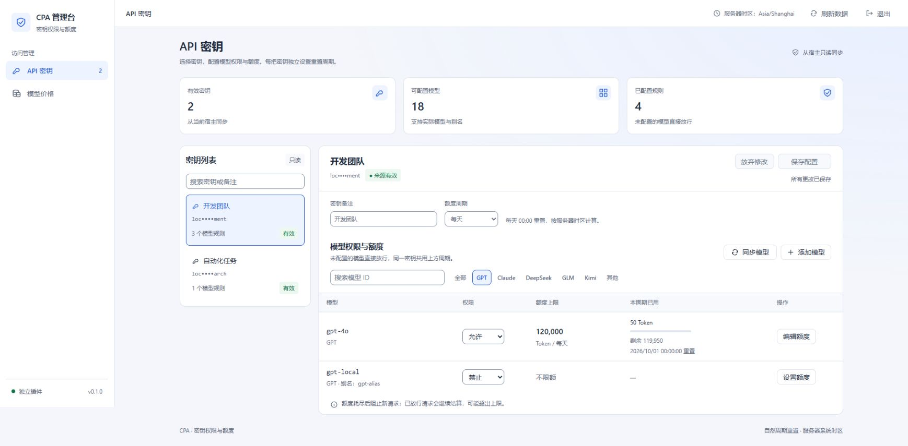
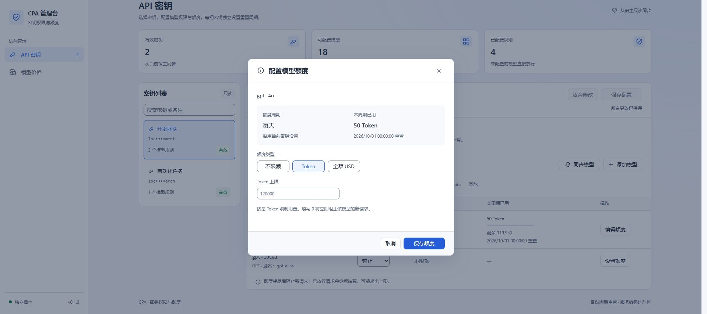

# CPA API 密钥权限与额度管理

[](https://github.com/junxin367/cpa-apikey-manager/actions/workflows/build-release.yml)

CLIProxyAPI 原生插件：读取宿主已创建的 API 密钥，独立开关全部模型共享的总额度，并选择按渠道或按模型配置权限与额度。额度支持 Token 或金额，自带独立中文管理页面。

[下载发布产物](https://github.com/junxin367/cpa-apikey-manager/releases/latest) · [插件注册表](https://raw.githubusercontent.com/junxin367/cpa-apikey-manager/main/registry.json) · [查看自动构建](https://github.com/junxin367/cpa-apikey-manager/actions)

## 功能

- 只读同步 `access.api-keys`，兼容旧配置根级 `api-keys` 字符串列表；不会修改或创建宿主密钥。
- 密钥列表顶部统一提供“查看完整／隐藏完整”，一次显示或隐藏全部有效密钥；每张卡片只保留复制操作。明文仅在管理员主动操作时通过已鉴权管理接口按需读取。
- 密钥列表标题栏提供“排序”：默认按用量百分比从高到低，也可切换为宿主顺序。用量百分比取每个密钥各额度中已用比例的最大值，与卡片进度条一致；没有额度或“全部模型禁止”的密钥按 0% 处理并排在最后，比例相同的密钥保持宿主顺序。排序方式在刷新数据和切换页面后保持，重新打开页面后恢复默认。
- 密钥搜索可直接匹配备注、脱敏值或完整密钥；完整密钥匹配在服务端完成，只向页面返回匹配的内部标识，无需先显示明文。
- 全局拦截与记账开关位于管理页面“设置”中，默认关闭；安装和配置阶段不拦截请求、不记录用量，完成配置并明确开启后才生效。
- 每把密钥有独立的总额度开关；关闭保留单位、上限和用量，重新开启沿用本周期已记录用量。
- 权限与分项额度二选一：按渠道，或按模型。切换后另一套规则暂停，配置和历史用量保留。
- 渠道仅由已知模型自动识别，与价格页使用同一归类，不再维护固定的可选列表。例如 `devin/claude-opus-5-5`、`model_claude_4_5_opus` 归入 Claude，`qwen3-coder-plus` 自动产生 Qwen 渠道，`grok-4` 自动产生 Grok 渠道；`k3`、`k3-256k` 等 Kimi 简写归入 Kimi。同家族经不同上游（包括 Antigravity）调用仍共享渠道额度。Antigravity 不再作为新增选项；已有配置标为“历史上游规则”，保留原有权限与额度，可编辑或删除。
- 总额度与当前模式的分项额度共同生效，任一耗尽即拦截；同一执行只记账一次。
- 全局功能开启后，只有能匹配到宿主 API 密钥、且已开启总额度或在当前模式下配置了规则的请求才进入权限、额度与记账流程。其余请求一律直接放行且不记账，包括：未携带密钥（如宿主未配置客户端密钥）、密钥无法匹配、其他插件发起的无客户端身份的内部调用，以及没有生效规则的密钥。缺失或无效密钥由宿主自身鉴权处理。已进入流程的密钥会记录所有获准生成请求，未配置范围默认允许。
- 模型 ID 可从宿主同步或手动添加；同步、添加或记录新模型后，渠道选项自动更新。无法从模型名提取家族的模型才归入“其他”，无需单独添加渠道。
- 校验宿主解析后的实际模型，多个已知别名共用目标模型的额度。
- 总额度与渠道／模型额度分别选择 Token／USD 上限；每把密钥独立选择一个日／周／月周期，所有额度共用。
- 按“设置”中的结算时区计算周期：每天 00:00、每周一 00:00、每月 1 日 00:00 重置；首次打开设置页时自动识别浏览器所在电脑的时区。
- 以自然周期汇总账本，无需午夜清空数据库；跨零点请求按准入开始时间归属，重启不会丢失已记账用量。
- 自动从 models.dev、LiteLLM、OpenRouter 补全缺失价格，带路由前缀（如 `devin/claude-opus-5-5`）或第三方平台写法的 Claude 模型也按官方价格匹配；支持手动设置，已有价格（包括 0）不会被覆盖。
- CPA 的括号推理等级（如 `devin/claude-sonnet-5-5(medium)`）与基础模型共用价格和模型额度统计，不作为独立模型列出。历史准入记录保留原始标识，真实用量通知可按基础模型关联，不会因等级后缀不同而进入待核对。
- 模型缺少价格不会拦截请求：请求照常放行并立即在后台补查价格，获得价格后自动补计此前未计价的用量。
- 金额按输入、输出和缓存单价计算，使用定点数保存，精确到 `0.000001 USD`。
- 配置切换保留用量；已有价格但尚未计价的历史用量先显示补计费用，再由管理员确认保存。
- 支持流式和非流式用量、重复通知去重、失败请求的实际消耗，以及缺失用量的人工核对。
- 设置页支持导出完整 JSON 备份和覆盖导入；备份包含权限、额度、价格、用量账本与密钥标识数据，适合容器更新后的恢复。导入先校验并保存当前数据的回退备份，无需关闭请求拦截，导入后保留当前拦截状态。
- 拒绝请求时返回中文原因和处理建议；额度耗尽时区分总额度／渠道额度／单模型额度，列出周期、已用量、上限及重置时间。
- 管理接口复用宿主管理鉴权；同源内嵌时自动复用官方管理中心已保存的凭据，其他部署可在插件“设置”页选择仅本次使用或保存到当前浏览器。

## 已验证环境与边界

- v0.6.12 在插件内兼容宿主断流后的空用量通知：失败、取消或被拒绝且没有非零用量、非零费用或人工记录的请求自动结束待核对，同时不再显示未计价提醒。保留请求、原用量和未知费用，迟到真实用量仍可补记；成功请求缺失用量、非零但不完整计量和缺费率仍需核对。数据库结构版本升至 6，继续支持 v5 备份导入；回退旧插件需恢复升级前备份。
- v0.6.11 修复非生成预热请求遗留待核对、共享 TraceID 的迟到用量关联错误，以及完整用量被去重忽略的问题；完整通知可修复同一执行的不完整记录，空通知不覆盖人工核对，多次执行共同决定请求是否仍待核对。通过 59 项 Rust 测试。没有真实用量的历史请求仍保留待核对，不自动清零或估算；详细取证和验证范围见验证记录。
- v0.1.0 基线在 Windows x64、CLIProxyAPI **v8.0.4** 官方二进制中实际加载 DLL，验证了 Chat Completions、Responses、Anthropic Messages，以及 SSE 流式请求。
- v0.6.8 密钥列表标题区新增“排序”，默认按用量百分比从高到低，也可切换回宿主顺序。用量百分比取每个密钥各额度中已用比例的最大值，与卡片进度条一致；没有额度或“全部模型禁止”的密钥按 0% 处理并排在最后，比例相同的密钥保持宿主顺序。排序只改变列表展示顺序，不影响权限、额度和记账。浏览器验收仅使用本地页面与模拟管理接口，未在 CPA 宿主中验收，范围见验证记录。
- v0.6.6 对齐 CPA-Manager-Plus 的默认服务等级口径：`auto`、空值和未报告等级使用标准服务价格，不再自动取 priority 等级的最高费率；明确的服务等级规则和长上下文判断保留。17 笔用量重放合计 `2.735354 USD`，与参考系统仅差逐笔六位小数取整。旧版已结算费用不自动重算，线上历史账本仍需单独核验修正。
- v0.6.5 修复 Devin 缓存写入未纳入计价总量的问题，补齐 AI Studio 与无缓存／推理分项的用量口径；待核对仅保留提示，不再以 503 阻止后续请求。权限禁止、已记录用量达到额度后的拦截仍保留；历史待核对数据不自动改写，未知服务等级仍沿用适用费率上限。验证范围见验证记录。
- v0.6.4 修复导入等待价格同步退出的阻塞，允许开启拦截时直接导入并保留原开关状态；保留在途请求的后续结算，不合并当前已结算历史。强化备份字段和账本关联校验，导入结果未确认时清除旧草稿并提示刷新检查。取消额外勾选确认，精简设置页说明；本地宿主管理接口与 Chrome 页面验证范围见验证记录，完整浏览器文件上传和远端 Docker 环境未复测。
- v0.6.3 为置灰的“导入备份”按钮增加悬停提示：拦截开启时提示 `请关闭上方“启用请求拦截”，再导入备份`，未连接和备份处理中显示对应原因，可导入时清除提示。导入限制及数据恢复逻辑不变；按要求未进行本轮本地测试或浏览器验收。
- v0.6.2 新增完整 JSON 数据备份与覆盖恢复，保留权限、额度、价格、用量账本和密钥标识；导入先校验并保存回退备份，恢复后保持拦截关闭。通过 41 项 Rust、4 项 JavaScript 测试、Windows Release 构建，以及隔离宿主新数据目录恢复与重启验证；Chrome 导出下载和恢复后展示通过，浏览器文件上传与确认导入步骤保留未验证。
- v0.6.1 简化自动计费规则：基础价格和规则使用同一来源，仅导入长上下文、服务等级两类独立规则，不跨源补入 batch／flex，也不自动展开组合档位。服务等级匹配后优先使用该等级费率，无需另配组合规则；旧自动价格同步更新，手动价格、请求快照和已结算费用不变。兼容 Claude 上游总量未包含缓存创建的口径差异，并移除人工核对的原因填写要求。通过 37 项 Rust、4 项 JavaScript 测试、Windows Release 构建与本轮 Chrome 价格展示、保存、校验和隔离宿主计价验证。
- v0.6.0 同步并结算长上下文与服务等级计费规则：价格页新增“计费规则”列和可折叠编辑器，支持 `>272K`、fast/priority、flex、batch、ultrafast 及组合档位；自动同步从 models.dev `cost.tiers`、`experimental.modes` 和 LiteLLM 的 `*_above_<门槛>_tokens`、`*_priority` 等字段导入规则，并一次性升级旧版只含基础费率的自动价格。通过 35 项 Rust、4 项 JavaScript 测试、Windows Release 构建、隔离宿主端到端验收，以及 Chrome 价格页规则展示与编辑验证。
- v0.5.4 渠道选择、价格页和执行记账统一按模型家族归类，Antigravity 不再作为新增选项；历史上游规则及用量保留，权限、额度和人工核对继续生效。数据库 schema 升至 5，升级前需备份。通过 27 项 Rust、4 项 JavaScript 测试、Windows Release 构建，以及宿主迁移和 Chrome 渠道选择、历史规则编辑、无模型禁用验证。
- v0.5.3 缺价请求照常放行并主动同步价格，自动或手动补价后补计已有未计价用量；兼容第三方 Claude 名称和路由前缀；渠道由已知模型动态识别并限制新增选择。通过 27 项 Rust 测试、Windows Release 构建、宿主缺价请求与补计验证，以及 Chrome 渠道选择、空列表、额度保存和编辑验证。
- v0.5.2 移除密钥列表卡片中的“待核对”标记，保留额度进度、详情核对操作和后台记账逻辑。
- v0.5.1 补全模型价格兼容匹配与 Gemini／Kimi 渠道识别；修复弹窗下拉遮挡、字段对齐和分项额度进度条；验证 Gemini、Claude 经 Antigravity 调用时共享该渠道权限与额度，并修复 Token 计数接口的渠道提前误判。
- v0.5.0 重做管理页布局与交互；新增结算时区设置（首次打开设置页自动识别浏览器时区）、Antigravity 渠道和“全部模型”禁止权限；只处理能匹配密钥且有生效规则的请求，其余请求直接放行。
- v0.4.1 将完整密钥查看合并到密钥列表顶部，支持在未显示明文时按完整密钥搜索，并将桌面密钥栏固定为 300px。
- v0.4.0 加入完整密钥按需读取、页面内拦截开关和无规则密钥旁路。
- v0.3.5 将单模型选择从浏览器原生候选菜单改为页面内可搜索下拉框，统一浅色样式并限制弹层高度，支持键盘选择和自定义模型 ID。
- v0.3.4 移除内嵌页面的固定侧栏，改用顶部面包屑和横向页面导航，并集中展示插件状态、版本、时区与刷新操作。
- v0.3.3 移除插件独立登录页；支持复用宿主管理中心保存的管理密钥，并提供浏览器本地凭据设置与清除入口。
- v0.3.2 新增默认关闭的全局拦截开关；关闭时请求、完成与用量回调全部旁路，配置异常不会影响模型请求。
- v0.3.1 支持宿主管理台内嵌，并自动识别宿主配置文件路径；配置路径解析与内嵌响应头通过回归测试。
- v0.3.0 总额度开关与渠道模式通过 20 项后台逻辑测试和 12 项隔离 DOM 交互测试。宿主与浏览器检查另见 [验证记录](docs/verification.md)，不将旧版推理验收视为本版已复测。
- 验证使用本地模拟模型服务，没有调用收费模型。完整结果见 [验证记录](docs/verification.md)。
- 自动构建覆盖 Windows x64、Linux x64、macOS Intel 和 Apple Silicon；Linux／macOS 尚未进行宿主功能验收。
- 不承诺兼容没有原生插件能力的旧宿主；支持旧密钥字段格式不等于支持所有旧版二进制。
- 第一版用于单个宿主进程，不提供多宿主共享额度。请勿让不同宿主共用同一数据库。
- **额度按实际结算用量限制后续请求，已经放行的并发或流式请求可能超额。**这不是严格预付费或消费绝不超限的计费系统。
- 宿主插件需要保持加载，并在管理页面“设置”中明确启用请求拦截才会拦截和记账。宿主禁用、卸载或熔断插件后，插件无法继续拦截请求。
- 本版按 Token 计费；生图模型按输入 Token 和图片输出 Token 计价，输入图片 Token 按文本输入价计算。未验证 Responses WebSocket，不提供按张数、音频、视频等单独计价。
- 插件安装前的历史用量不自动补造。页面显示开始记录时间。

## 安装

可以将本仓库的 [registry.json](https://raw.githubusercontent.com/junxin367/cpa-apikey-manager/main/registry.json) 添加到 CPA 的插件商店注册表，也可以从 [GitHub Releases](https://github.com/junxin367/cpa-apikey-manager/releases/latest) 手动下载对应平台的 ZIP。ZIP 内动态库已使用正确的插件文件名。使用 Release 的 `checksums.txt` 校验下载文件，ZIP 内 `SHA256SUMS.txt` 校验安装用动态库。

1. 将对应平台的动态库放到宿主 `plugins` 目录，文件名必须是：

   | 平台 | 安装文件名 |
   | --- | --- |
   | Windows x64 | `cpa-apikey-manager.dll` |
   | Linux | `cpa-apikey-manager.so` |
   | macOS | `cpa-apikey-manager.dylib` |

2. 将本项目 `config.example.yaml` 中的 `plugins` 配置合并到现有宿主配置：
   - `cpa-config-path`：可选。插件默认识别宿主的 `-config/--config` 启动参数；未指定参数时读取宿主工作目录下的 `config.yaml`。外部配置存储或其他非标准部署无法自动识别时，再填写实际配置文件绝对路径。
   - `cpa-base-url`：该宿主的 HTTP(S) 地址，用于读取模型目录。
   - `data-dir`：可写的数据目录，推荐绝对路径。

3. 宿主需要启用管理 API 并设置管理密钥。v8 配置位于 `management.secret-key`；客户端 `access.api-keys` 不能代替管理密钥。
4. 启动或重启宿主。在日志确认插件加载成功，并确认不存在 `invalid metadata`、注册失败或熔断错误。
5. 在宿主“插件管理”中打开“密钥权限与额度”。也可以直接打开下面的页面，并将端口改成你的宿主端口：

   ```text
   http://127.0.0.1:8317/v0/resource/plugins/cpa-apikey-manager/index.html
   ```

6. 如果官方管理中心已保存管理密钥，插件会自动连接。否则进入“设置”页填写一次，可保存到当前浏览器或仅在本次页面使用。连接后选择客户端密钥，填写备注与额度周期，在“限制设置”中配置规则；确认无误后回到“设置”，启用“请求拦截”。只有存在生效规则的密钥会进入拦截与记账流程；这些密钥遇到配置或存储异常时采用保护性拦截。

页面及静态资源嵌入动态库，无需 Node.js、前端构建或独立 Web 服务器。宿主管理台通过 iframe 内嵌插件页面，兼容管理前端与 API 使用不同来源的部署。公开页面资源不含密钥和用量数据；实际数据接口必须通过宿主管理鉴权。同源部署可以读取官方管理中心勾选“记住密码”后保存的凭据；跨来源部署无法读取父页面存储，需要在插件“设置”页单独保存。该凭据使用与官方管理中心同类的可逆混淆，只用于避免肉眼直读，不构成加密安全边界。通过反向代理部署时，需要同时转发插件资源路径和管理 API 路径。

新同步密钥默认关闭总额度，使用按模型模式。若当前模式没有规则，该密钥直接放行且不创建用量记录；启用总额度或添加当前模式规则后，插件才检查权限与额度，并记录该密钥所有获准生成请求。已进入处理流程后，未配置范围仍默认允许，只有当前模式的显式禁止规则返回 403。纯 Token 计数接口只检查权限，不消耗生成额度。本版不提供未配置范围的默认权限开关。

## 管理页面

顶部横向导航包含 **API 密钥**、**模型价格** 和 **设置**，面包屑显示当前页面，没有用量明细页。宿主管理中心内嵌时不再显示第二列固定侧栏。

- 页面启动时优先复用官方管理中心保存的管理密钥，不再显示第二个登录页。设置页可替换或清除插件页面自己保存的凭据，不会修改宿主管理中心的登录状态。
- “设置”页提供全局请求拦截开关。切换后立即生效并保存在插件数据库中，不需要返回宿主插件配置；关闭时规则和历史用量保持不变。
- 密钥列表顶部提供统一的“查看完整”按钮，一次读取并显示全部有效密钥，再次点击统一隐藏。显示状态在保存配置、刷新数据、切换页面后保持，宿主新增的密钥自动读取明文；只有点击“隐藏完整”、断开或更换管理凭据、重新打开页面时才清除明文。密钥卡片高度统一，超长内容单行省略；右上角的复制图标在悬停或键盘聚焦卡片时出现，复制成功后短暂显示勾选；卡片同时显示周期、规则数、总额度进度以及已耗尽／待核对／已禁止标记。桌面宽度下密钥列表与右侧详情各自独立滚动。搜索完整密钥不要求先点击“查看完整”，管理接口只返回匹配的内部标识。
- 顶部状态区显示全局拦截是否启用。未启用时仍可检查密钥、价格和规则，但请求不会被插件拦截或记账。
- 页面采用按需添加：默认不展开全部渠道或模型，只在列表中显示已经配置的限制。空状态说明当前密钥直接放行且不记账，并提供“添加第一个限制”入口。
- 总额度只有一个紧凑开关。首次开启会先弹出“全部模型”限制：权限为“允许”时需设置 Token 或 USD 上限；权限为“禁止”时无需额度，该密钥的所有新请求都返回 403 `key_forbidden`，卡片显示“已禁止使用”。“全部模型”行的权限开关可随时切换；禁止时保留已设置的总额度，没有额度时改回允许会先要求设置上限。关闭开关后设置行收起、禁止不再生效，但权限、上限和用量仍保留，重新开启继续沿用。
- “添加限制”可选择全部模型、渠道或单个模型。渠道只能选择已识别出的选项；尚无模型时提示先“同步模型”，不能保存空渠道。模型可输入或从宿主目录选择。已有但暂未识别到成员模型的渠道规则保留，可编辑或删除，但不作为新增选项。渠道与模型限制仍严格互斥：添加另一种范围时会先提示当前规则将保留但暂停。
- 单模型选择器使用与页面一致的可搜索下拉框，最多展示 60 个即时匹配结果，超出时提示继续输入筛选；支持方向键、Enter、Escape，也允许直接填写宿主暂未同步的模型 ID。
- 已添加的渠道／模型行可直接修改允许／禁止、编辑或移除额度。密钥已有生效规则时，未添加的范围默认允许且不限额，不在页面中占行。
- 渠道／模型额度可选择“不限额／Token／金额 USD”。Token 与金额分别保留本次编辑输入，切换单位不自动换算。总额度关闭与分项不限额均不会清空已记录用量。
- 备注、密钥周期和行内权限通过顶部“保存配置”提交；在额度弹窗中保存时，当前密钥尚未保存的修改会一并提交。切换密钥、页面或刷新数据时不弹出未保存提醒，各密钥的草稿在当前页面内保留，切回后可继续保存或放弃；关闭或重新打开页面后草稿不保留。
- 价格页支持名称与价格状态筛选，展示价格来源、同步日期及后台同步状态。
- 页面参考 CPA-Manager-Plus 的浅色管理台风格；使用统一设计变量、14px 正文、32px 紧凑控件和最大 1440px 内容区。顶部导航会在中等宽度自动换行，窄屏隐藏次要状态信息；权限选择框宽 88px，额度输入框宽 224px。密钥详情区宽度不足 820px 时，限制列表收紧间距并将编辑按钮收起为图标；价格表在内部横向滚动；限制列表在 760px 以下改为逐条堆叠展示。
- 顶部状态标签和“拦截未启用”提示条可直接跳转到“设置”。密钥详情支持 `Ctrl+S` 保存；密钥列表支持方向键切换焦点，搜索框支持 `Esc` 清空。价格状态筛选以分段按钮显示各状态数量。
- “密钥总额度”保留整把密钥的异常核对入口；渠道／模型行提供对应范围入口。页面说明密钥是否进入拦截与记账流程，并提示已有账本可能缺失插件停用期间的数据。

以下截图为 v0.1.0 历史基线，未展示 v0.3.0 的按需限制列表。





## 额度与价格规则

### 总额度与渠道／模型额度

例如，同一把密钥每天总额度为 **100,000 Token**，模型 A 单独限制 **50,000 Token**：

- A 用到 50,000 Token 后，A 的新请求被拦截；其他模型仍可使用剩余总额度。
- A、B 及其他模型累计用到 100,000 Token 后，该密钥所有模型的新请求均被拦截。
- A 的一次请求同时参与总量和单模型汇总，账本只保存一次。

总额度和单模型额度也可以使用不同单位，例如总计每天 10 USD，模型 A 每天 50,000 Token。金额总额度将各模型按各自单价计算的费用相加。

按渠道时，例如 GPT 渠道每天 50,000 Token，所有 GPT 家族实际模型共享该上限，Claude 等其他渠道独立。渠道金额额度将各模型按各自单价计算的费用相加，不使用统一渠道单价。

启用总额度或切换模式时汇总本周期已有记录。只要当前模式仍有规则，关闭总额度期间的获准请求也会继续记账；若总额度关闭且当前模式没有规则，该密钥直接旁路，这段消耗不会补造。插件安装前、全局停用期间和无规则旁路期间的消耗同样不会补造。关闭额度或修改上限不清空历史账本。

### 周期

| 周期 | 新额度开始时间 |
| --- | --- |
| 每天 | 当前时区次日 00:00 |
| 每周 | 当前时区下周一 00:00 |
| 每月 | 当前时区下月 1 日 00:00 |

周期在每把密钥的详情顶部设置。“当前时区”指“设置 → 时区”中的结算时区（IANA 名称，保存在 SQLite `meta.accounting_timezone`）：

- 服务端尚未保存时区时，暂用宿主服务器系统时区；管理员打开设置页时，页面自动识别浏览器所在电脑的时区并保存。
- 已保存后不再自动覆盖；可在设置页搜索并选择其他时区，或在浏览器时区不同时点击“使用浏览器时区”。
- 旧插件配置或数据库中的 `timezone` 不参与计算。

周期或时区改变时按新边界重新汇总已有记录，不删除历史用量。

“不限额”和“额度为 0”不同：不限额移除当前分项上限；总额度开启且为 0 时拒绝所有模型的新请求，渠道／模型额度为 0 只拒绝对应范围。总额度关闭时保留的 0 不参与拦截。只有当前模式的禁止规则生效，不会因存在额度而开放。

额度耗尽返回 429、`quota_exceeded`、`reset_at` 和 `Retry-After`。降低额度至已用量以下立即阻止新请求；提高额度后可恢复调用。

### 金额

价格单位为 **USD / 100 万 Token**。输入价和输出价必填；缓存读取／写入价留空时沿用输入价。推理 Token 已包含在对应输出部分，不重复计价。

```text
费用 =（普通输入 × 输入价 + 输出 × 输出价
      + 缓存读取 × 缓存读取价 + 缓存写入 × 缓存写入价）/ 1,000,000
```

每次执行总费用向上取整到 `0.000001 USD`。公开目录价格仅作为参考，不代表上游实际账单，也不读取上游账户余额。

价格页的“计费规则”只按长上下文和服务等级两类规则自动导入，不展开二者的组合。例如来源中的 `gpt-5.5` 只有 `>272K` 和 fast/priority 时，自动价格也只保留这两条，不从其他目录补入 batch、flex 等规则。长上下文门槛按**普通输入＋缓存读取＋缓存写入**判断，严格大于门槛时整次执行使用满足条件的最高门槛费率，不只对超出的部分加价；匹配到服务等级规则时优先使用该等级费率，不要求额外配置组合档位。缓存费率留空时沿用该条规则的输入价。

结算优先采用宿主 `ResponseServiceTier`，为空时采用 `ServiceTier`；`default`／`standard` 为标准服务，`fast` 视为 `priority`。宿主未报告等级、报告空值或 `auto` 时，按标准服务计价，输入超过已配置的长上下文门槛时仍使用对应上下文费率，不因价格表存在 priority 规则而自动加价；这一默认口径与 CPA-Manager-Plus 一致。已知非标准等级却缺少对应规则时，记录为待核对，不按基础低价结算，也不阻止后续请求。管理员补齐费率后会补计并解除价格缺失造成的待核对；人工核对时也可以指定实际服务等级。已有手动组合规则和已放行请求的价格快照继续兼容。此调整不自动重算已计价历史记录，旧版误计费用需要先逐笔核验再修正。

修改价格对之后放行的请求生效；已放行请求保留价格快照，准入时没有价格的请求在结算时使用届时已有的价格。切换到金额额度时，当前周期内已有价格的未计价记录先按当前单价补计并确认；缺价模型的记录保持未计价。

总金额额度覆盖全部模型的已记录用量；与当前渠道／模型金额额度重叠的用量只补计一次。渠道金额只检查该渠道历史用量。暂停的模式规则和关闭的总额度不要求补价。单模型金额额度需要先为该模型设置价格才能保存。

模型缺少价格时不拦截请求：请求照常放行并记为未计价，插件立即在后台补查该模型的价格（见下节）。自动同步补全价格或管理员保存价格时，按该价格补计这个模型尚未计价且 Token 明细完整的用量，并写入审计记录；已计价的费用不变。获得价格前，未计价用量不计入金额额度，页面以“N 条未计价”提示，这段时间的消耗可能超出金额上限。

### 自动补全价格

启动、发现新模型以及默认每 6 小时检查一次缺失价格，也可以在价格页点击“同步缺失价格”。请求遇到缺价模型时立即补查，不等下一个周期：同一模型每小时最多补查一次，补查时重新下载超过 10 分钟的价格目录；`price-sync.enabled: false` 时不自动补查。固定来源顺序如下：

```text
https://models.dev/catalog.json
https://raw.githubusercontent.com/BerriAI/litellm/main/model_prices_and_context_window.json
https://openrouter.ai/api/v1/models
```

优先接受明确且唯一的模型匹配；models.dev 优先采用官方规范模型身份。所有来源精确匹配均失败后，再按同样顺序做兼容匹配：

- 去掉路由前缀：CPA 的 `prefix` 路由或第三方平台把模型写成 `devin/claude-opus-5-5`、`team/gemini-3.6-flash` 时，按 `/` 之后的模型名查价。
- 去掉 CPA 的推理强度／思考后缀：`-thinking`、`-think`、`-high`、`-medium`、`-low`、`-minimal`、`-xhigh`、`-none`、`:thinking` 及 `(8192)` 这类预算写法，例如 `gemini-3.6-flash-high` → `gemini-3.6-flash`。
- Kimi 简写补全为 `kimi-` 前缀，例如 `k3` → `kimi-k3`。
- 第三方平台的 Claude 写法换成官方名称再查：`claude-4.5-sonnet`、`claude-sonnet-4.5`、`anthropic--claude-4-5-sonnet`、`claude-sonnet4-5`、`MODEL_CLAUDE_4_5_SONNET`、`us.anthropic.claude-sonnet-4-5-20250929-v1:0` 都按 `claude-sonnet-4-5` 这类官方名称（及 OpenRouter 的点号写法）匹配；目录里没有该快照日期时退回不带日期的名称。`thinking`、`latest` 和 `1m`（百万上下文版本，仍按实际输入量选择长上下文档位）不影响匹配；名称中出现 `fast`、`free` 等可能单独计价的词时不转换。
- 版本号改用点号：部分平台把 `gpt-5.4-mini`、`gemini-3.8-flash`、`kimi-k2.6` 写成 `gpt-5-4-mini`、`gemini-3-8-flash`、`kimi-k2-6`，会把第一组一两位数字之间的短横线改成点号再查，`2024-05-13` 这类日期不变。
- 裸名称被多个转售渠道共用时，按渠道补上官方厂商前缀再查（如 `moonshot/kimi-k3`、`anthropic/`、`openai/`、`google/`）。
- 仍未找到时，若至少两个同族变体价格完全一致，则采用该价格，例如 `gpt-image-2.5` 取 `gpt-image-2.5-flare`／`-sunburst` 的共同价格；变体价格不同时不采用。

LiteLLM 的生图模型（`image_generation`）按 `output_cost_per_image_token` 作为输出价，按张计价的条目忽略。存在歧义、缺少输入／输出价、来源不可用时保持未设置，页面说明结果；每个自动价格都记录实际采用的来源模型，可在价格表中核对。LiteLLM 和 OpenRouter 的每 Token 价格会转换为每百万 Token 价格，科学记数法采用十进制定点解析。

自动同步补全从未设置的价格，并一次性升级旧版自动价格（包括曾跨源合并规则的价格）：使用当前选中目录的基础价格和两类独立规则，去掉跨源补入的规则及自动组合档位。升级完成后不周期性改价。管理员设置的价格和零价格不会被覆盖。后台任务使用独立数据库连接；升级前再次核对版本和自动来源，并发手动保存优先，不阻塞模型请求等待外网。目录不可用时保留现有价格，之后重试。升级不改变已放行请求的价格快照和已计价费用。同步只匿名下载公开目录，不发送客户端密钥、管理密钥或用量数据。

旧管理页客户端保存基础价格时如果省略 `rules`，服务端会继承当前计费规则，避免改价时丢失规则。`price-sync.enabled: false` 会同时停用规则补齐。

基础价格与规则来自同一个选中目录，不跨源补齐。导入基础文本输入、输出、缓存读写费率，以及 models.dev `cost.tiers` 的上下文档位和 `experimental.modes` 的服务等级价格；旧目录没有档位列表时兼容 `context_over_200k`。仅当优先目录无法匹配模型时才使用后续目录；LiteLLM 的独立 `*_above_<门槛>_tokens`、`*_priority`、`*_flex`、`*_batches`、`*_ultrafast` 规则按每百万 Token 转换，组合字段不导入。价格来源列同时代表基础价格和自动导入规则的来源。

不导入按张、工具调用、缓存存储时长、音视频及区域附加费等特殊计费。缓存费率缺失时沿用该档输入价，明确的零价格会保留。自动补价不修改已计价费用，只补计尚未计价的用量。公开目录可能不完整，实际账户费率也可能不同；缺价期间放行、已经放行的单次大请求及并发／流式请求仍可能超出额度，**本功能不是严格消费硬上限**。

`price-sync` 的开关、1～168 小时检查间隔和镜像 URL 在宿主插件配置中设置，见 `config.example.yaml`。全部来源失败时保留有效价格，并在 5 分钟后重试。

### 拒绝请求的中文错误

插件统一以 `application/json; charset=utf-8` 返回错误。`error.message` 是供用户阅读的中文说明，`error.code` 保留稳定的机器错误码，便于调用程序判断原因。例如：

```json
{
  "error": {
    "code": "model_forbidden",
    "message": "请求被拒绝：当前 API 密钥无权调用模型「gpt-local」。请联系管理员开通该模型权限。"
  }
}
```

| HTTP 状态 | 错误码 | 中文说明包含的信息 |
| --- | --- | --- |
| 403 | `model_forbidden` | 被禁止的实际模型、联系管理员开通权限 |
| 403 | `key_forbidden` | 该密钥的“全部模型”权限为禁止、联系管理员开通权限 |
| 403 | `channel_forbidden` | 被禁止的模型家族渠道、实际模型、联系管理员开通权限 |
| 429 | `quota_exceeded` | 总额度、渠道或单模型额度、周期、已用量、上限、重置时间和时区 |
| 503 | `accounting_unavailable` / `storage_unavailable` | 记账或数据库异常、管理员检查和恢复办法 |
| 503 | `key_source_unavailable` / `plugin_unavailable` | 宿主配置或插件异常、检查相应配置。宿主配置读取失败时，只影响有生效规则的密钥和无法匹配的密钥；未携带密钥及无规则密钥照常放行 |
| 503 | `request_context_unavailable` | 宿主缺少请求标识、检查版本兼容性 |
| 400 | `missing_model` | 请求缺少模型、填写 `model` 字段 |

额度错误同时提供 `error.scope`（`total`／`channel`／`model`）、`channel`、`channel_label`、`model`、`unit`、`period`、`used`、`limit`、`reset_at` 和 `timezone` 字段，以及 `Retry-After` 响应头。`model` 始终是本次请求的实际模型；`reset_at` 是 UTC 的 RFC 3339 时间，中文消息中的重置时间按结算时区显示。Token 数和金额均用字符串返回，避免大数精度丢失。

流式请求在准入时被拒绝，也会收到上述 JSON 错误。宿主在进入插件前产生的鉴权错误及上游服务错误由对应服务决定。

### 用量异常

完成通知先到不代表用量为 0。完成后超过 30 秒仍无用量，或插件重启发现遗留未结算请求，会将其标记为“待核对”。待核对状态在访问管理页或处理新请求时检查。宿主明确标记 `generate=false` 的预热请求只检查权限，不建立待结算记录；旧准入记录收到对应的非生成完成／用量通知时，在没有已记用量的前提下自动结束待核对。

请求完成结果为失败、取消或被拒绝，且没有非零 Token、非零费用或人工核对记录时，插件将其记为“异常结束，未报告用量”（内部状态 `unmeasured`），不再要求人工核对，也不显示未计价提醒。该规则适用于历史记录和新请求，包括宿主用量通知误报“成功、0 Token”的情况。它不表示消费为零：原始账本和未知费用保留，后续收到真实非零用量仍按准入价格自动结算、去重。成功或结果未知的请求缺失用量，以及任何非零但不完整的用量，不适用该规则。

同一 WebSocket 连接可能共用 TraceID；请求 ID 不同时，插件按密钥、模型和执行开始／完成时间关联用量，不再把迟到通知归给最新请求。无法唯一匹配时仍保留待核对。同一执行先收到空用量、后收到完整 Token 时，更新原账本并记录修复审计，重复通知不重复扣费。一个请求有多个执行／重试时，所有执行用量完整且适用费率齐全才结束待核对；缺少模型价格仍沿用自动补价流程。

待核对不会阻止密钥调用，只在对应额度区域提示。金额额度只累计已计价费用，待核对请求在核对前不计入金额；Token 额度继续计入已记录的 Token。管理员在对应额度区域点击“处理待核对”，填写 Token 明细和服务等级；迟到的真实用量会替换人工记录，避免重复扣减。未知／不一致的 Token 计量不会悄悄按零费用处理。

Token 口径按宿主执行器识别：Claude 为各项独立，OpenAI 类输入包含缓存，Gemini／AI Studio／Vertex／Antigravity 推理单独计数。CLIProxyAPI 的 Devin 执行器把缓存读取计入输入和总量，缓存写入单独上报且不计入总量，插件按普通输入＋缓存读取＋缓存写入＋输出计价。其他执行器只有普通输入和输出时直接计价，含缓存或推理但口径未知时转为待核对。

数据库写入失败时会阻止后续调用，修复数据目录或磁盘问题后重启插件。宿主配置来源不可读时同样返回 503，读取恢复后自动同步。

### 旧数据迁移

旧规则中的逐模型周期统一迁移为密钥级周期：原周期相同时保留，存在不同周期时采用每月，没有额度规则时采用每天。管理员可再为每把密钥调整周期。旧 `default_access` 被移除，旧请求和用量记录保留。旧策略缺少 `total_quota` 时视为未设置总额度，保持原有单模型行为，不会自动开启总限制。

v0.3.0 默认将旧策略迁移为按模型模式；已有总额度自动开启，没有总额度则关闭。数据库 schema 升至 2，为旧记录按实际模型回填渠道，保留原 Token、费用和时间，不重新计费。升级前备份整个数据目录；回退旧版本时同时恢复对应备份，不要让旧版本写入升级后的数据库。

动态渠道识别将数据库 schema 升至 4，历史“其他”记录重新归类，费用与 Token 不重算。原“其他”规则复制到拆分出的渠道，已有明确规则优先；原共享额度拆分后成为各渠道独立上限。需要继续控制全部模型共享消耗时，请使用密钥总额度。

统一模型家族渠道将 schema 升至 5，历史 Antigravity 请求和用量按实际模型重新归类，Token、费用和时间不变；另外保留上游标记，让已有 Antigravity 规则继续沿用原有汇总。模型家族规则与历史上游规则同时存在时，禁止优先、任一额度耗尽均拦截，但不重复记账。删除历史规则后不能重新新增。升级前请备份数据目录，回退旧版本时需恢复对应备份。

旧客户端 PUT `/policy` 省略 `total_quota_enabled`、`rule_mode` 或 `channel_rules` 时保留数据库中的对应值，不会意外重置新配置。显式开启总额度但没有上限会被拒绝；旧客户端清空上限时若总开关仍开启，也会返回明确错误。

## 从源码构建

通过 rustup 使用 `rust-toolchain.toml` 固定的 Rust 1.95.0 工具链。Windows 使用 MSVC 工具链和 Visual Studio C++ Build Tools；Linux／macOS 需要 C 编译器（SQLite 随包构建）。打包脚本需要 PowerShell 7。

```powershell
pwsh -File scripts/build.ps1
```

脚本生成 `dist/cpa-apikey-manager-windows-x64.zip`，其中包含动态库、配置示例、本文档、MIT 许可证、验证记录、页面截图和 SHA-256 校验文件。实际平台名称随运行系统变化。

加上 `-ReleaseAssets` 会按 CPA 插件商店格式生成包含版本和平台的 ZIP，例如 `cpa-apikey-manager_0.3.0_windows_amd64.zip`。

也可以直接构建：

```text
cargo build --release --locked
```

将 `target/release/` 中的 `cpa_apikey_manager.dll`、`libcpa_apikey_manager.so` 或 `libcpa_apikey_manager.dylib` 重命名为前述安装文件名。不要把 Rust 自动生成的下划线文件名直接作为插件 ID 使用。

插件元信息默认使用 `Cargo.toml` 中的本仓库地址。GitHub Actions 会通过 `CPA_PLUGIN_REPOSITORY` 写入实际构建仓库地址，派生仓库无需修改插件源码。

## GitHub 自动构建与发布

发布方式参考 [cpa-window-primer](https://github.com/junxin367/cpa-window-primer)，使用一个工作流完成检查、四平台构建和产物发布：

| 触发方式 | 行为 |
| --- | --- |
| 推送 `v*` 版本标签 | 校验标签与 Cargo 版本一致，执行源码检查和四平台构建，随后自动创建或补全 GitHub Release |

每个平台上传一个符合 CPA 插件商店命名规则的 ZIP，另提供汇总 `checksums.txt`、中文发布说明和 `latest.json`。仅在所有平台构建成功后发布完整产物；编译阶段只读仓库，发布阶段才允许写入 Release。Action 固定到提交 SHA，Rust 版本固定在 `rust-toolchain.toml`，依赖使用 `Cargo.lock`。

普通分支推送和 Pull Request 不触发本工作流。标签构建产生的 Actions 临时产物保留 14 天，正式版本产物保存在 GitHub Releases。Linux 使用 Ubuntu 22.04 构建，macOS 分别使用 Intel 与 Apple Silicon 原生运行器。

发布新版本时先更新 `Cargo.toml` 的 `version`，运行 Cargo 同步 `Cargo.lock` 并提交，再推送同版本标签，例如：

```text
git tag v0.3.0
git push origin main v0.3.0
```

标签必须指向包含工作流的提交，且版本与该提交的 `Cargo.toml` 一致。带预发布后缀的标签（如 `v0.3.0-rc.1`）会创建 GitHub 预发布版本。

## 备份与卸载

### 导出与导入

在插件“设置 → 数据备份”点击“导出备份”，下载完整 JSON 文件。运行时导出使用数据库事务读取一致快照，不需要停止宿主；支持不超过 64 MB 的文件，历史数据超过限制时请停止宿主后备份整个 `data-dir`。导出文件请保存到容器之外。

备份包含密钥权限与额度、模型目录、自动和手动价格、价格来源、请求及用量账本、人工核对及审计记录、结算时区、记账起点，以及密钥 HMAC 标识所需的随机密钥。整数以字符串保存，避免浏览器处理较大计数时丢失精度；SHA-256 用于校验文件完整性。文件未加密，虽不含客户端 API 密钥明文或管理密钥，仍包含使用记录和密钥标识数据，请妥善保管。

容器更新后按以下步骤恢复：

1. 恢复宿主的 YAML 配置和原有 API 密钥，配置插件的 `data-dir`。插件备份不会修改宿主配置、上游凭据或浏览器管理凭据。
2. 在插件设置中选择“导入备份”并上传 JSON 文件，无需关闭“启用请求拦截”。导入会覆盖当前账本，建议选择请求较少时操作。
3. 文件通过校验后，查看备份时间、密钥记录、用量数量和覆盖提示，点击“覆盖并恢复”，无需额外勾选。导入覆盖当前插件数据，不合并当前已结算历史。
4. 插件会先在当前 `data-dir` 中保存 `backup-before-import-*.json` 回退备份，然后在单个事务中恢复；校验、保存回退文件或恢复失败时，当前数据不会被部分覆盖。恢复后仍使用当前服务器上的原有 API 密钥来匹配历史记录，宿主中没有的密钥保留为非活动记录。
5. 检查恢复的额度、价格与用量。导入后沿用导入前的请求拦截状态，不从备份覆盖开关。备份中的未完成请求，以及当前可关联原有宿主密钥的在途请求，会转为待核对；当前在途请求后续收到用量时继续结算，避免丢失消耗。

如果页面提示“导入结果未确认”，可能是请求超时或连接中断，不能据此判断后台恢复失败。页面会清除旧草稿，请刷新检查数据，确认结果前不要重复导入；明确返回恢复失败时保留原草稿。

导入仅支持本功能导出的完整备份和当前数据库结构版本；较新版本生成的不兼容备份会被拒绝。需要回退时，从服务器 `data-dir` 取出导入前保存的 JSON，再按相同步骤恢复。

### Docker 数据持久化

备份用于手动恢复；更新容器时直接保留数据，应将插件 `data-dir` 挂载到宿主机目录或 Docker 数据卷。例如，在现有 Compose 的 CPA 服务中追加：

```yaml
services:
  cpa:
    volumes:
      - ./cpa-apikey-manager-data:/data/cpa-apikey-manager
```

并在宿主配置的插件段中设置：

```yaml
plugins:
  configs:
    cpa-apikey-manager:
      data-dir: "/data/cpa-apikey-manager"
```

这里的服务名应替换为实际 CPA 服务名，保留现有挂载与插件配置。每次重建容器继续使用同一个宿主目录或数据卷，不要删除该目录或卷。宿主 YAML、客户端密钥和上游授权文件仍需按宿主自身方式持久化。

先停止宿主再做文件级备份时，应复制整个 `data-dir`，不要单独复制运行中的 SQLite 主文件，以免遗漏 WAL 中尚未合并的数据。

卸载前明确设置 `plugins.configs.cpa-apikey-manager.enabled: false`，停止宿主后移除动态库。数据库可以保留，以便以后恢复；插件停用期间不会记录或限制用量。

## 源码结构

```text
src/native.rs      C ABI、生命周期与 RPC 分发
src/config.rs      宿主密钥和模型别名同步
src/accounting.rs  自然周期、定点金额、Token 归一化
src/engine.rs      权限、额度、用量结算和持久化
src/channel.rs     模型家族识别与额度范围
src/migrations.rs  数据库版本迁移与渠道回填
src/price_catalog.rs  公开目录解析、模型匹配和精确费率转换
src/price_sync.rs     后台自动补价、来源回退与并发保护
src/schema.sql     SQLite 表及索引
src/web.rs         管理接口与页面资源
ui/               独立中文管理页
scripts/build.ps1  构建与打包
scripts/release.mjs  版本校验、发布说明、校验清单与 latest.json
registry.json  CPA 插件商店注册表
.github/workflows/build-release.yml  四平台自动构建与发布
```

具体验证范围与结果见 `docs/verification.md`。
