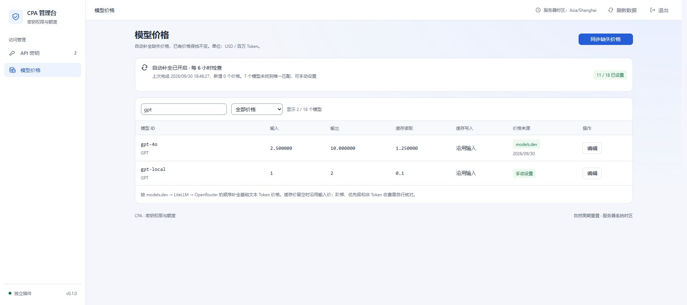

# 验证记录

验证日期：2026-10-19；历史版本验证见各节。

环境：Windows x64、Rust 1.95.0，服务器系统时区为 `Asia/Shanghai`。v0.1.0 基线使用 CLIProxyAPI v8.0.4 官方 Windows 二进制，宿主提交 `d33f63f8e3d98428440ebca5a5b6a981a61ff71e`。

历史基线的模型推理使用本机模拟上游和临时密钥，没有调用收费模型，也未修改用户已有部署。基线价格目录同时进行了可控模拟和真实公开 GET 验证。以下分别记录新增功能和原有基线，基线宿主与浏览器结果不代表已对新版本重复验收。

## v0.6.11 待核对请求恢复修复（2026-10-19）

### RCA 结论

- 状态：插件缺陷已复现并修复；线上异常的整体原因部分确认。
- 现象：线上插件为 v0.6.10，存在已结束但持续待核对的请求；部分请求在 CPA Manager 中能查到 Token。
- 直接原因：`Generate=false` 用量被直接忽略，但此前已经创建的准入仍停留在 pending，随后超时转为 review。另有同一 TraceID 的迟到用量归错请求、相同执行的补全通知被去重丢弃的可复现路径。
- 根因：准入阶段未采用宿主的非生成标志；关联逻辑假设同一 TraceID 只需选择最新请求；去重没有区分完整记录与尚待补全记录。
- 系统性根因：准入、完成、用量三个入口未一致维护非生成请求的状态；原回归没有覆盖同一连接多次执行、用量通知乱序及不完整通知升级。请求状态还会被最后一条通知覆盖，隐藏同一请求其他未完成计量的执行。
- 关键因果链：非生成请求被准入 → 非生成用量直接返回 → 准入无结算路径 → 超时待核对。其他分支为：同一 trace 多次准入 → 较早执行用量迟到 → 归入最新准入；空用量先入账 → 完整通知 ID 已存在 → 补全被忽略。

### 证据

| 判断 | 类型 | 证据与来源 |
| --- | --- | --- |
| 非生成请求留下待核对 | 事实 | 只读对比插件备份与 CPA Manager 监控：一条 Responses WebSocket 请求有 19,126 Token、`generate=false`，插件对应准入为 review、无 usage；同一 trace 后续 8 次实际生成均有正常记录 |
| 截图中的两条 Claude 请求没有可回填的 Token | 事实 | 按插件准入 trace 查询监控，两条均为 Devin 流式生成，监控 Token 分项和总量均为 0；插件各有一条 0 Token、不完整记录，完成结果均为 canceled |
| 去重与关联缺陷可重复触发 | 事实 | 修复前六个新增用例全部失败：非生成准入、非生成通知关闭、共享 trace 迟到通知、重叠候选拒绝、空通知补全、重试完整性；修复后通过 |
| 手工核对不会被空通知覆盖 | 事实 | 补充回归验证：人工记录保留；随后完整真实用量替换人工记录，重复通知只保留一笔账 |

### 已排除解释

- 本次抽查的待核对没有非零 Token 的未计价用量，不能用缺少模型价格解释截图中的全零记录。
- 截图中的两条通知已经关联到正确准入，因此它们不属于模型别名或请求 ID 匹配失败；监控中存在记录，但该记录的 Token 本身也是 0。
- `generate=false` 请求在监控中有输入 Token，不等于插件应按实际生成收费；原用量入口明确忽略此类请求，本次修复保持该既有行为并补齐准入／完成状态。

### 异常状态溯源

- 适用约束：宿主明确声明非生成请求时，插件只检查权限，不留下等待生成用量的准入；对已准入实际生成，仅完整、可归属的真实用量可结束核对，重复执行通知不得增加扣费。
- 依据：宿主 `Generate`／`Metadata.generate` 契约、原非生成旁路行为、项目缺失用量核对及重复通知去重契约。线上非生成样本命中；本地用例复现状态违反。
- 状态路径：宿主携带非生成标记 → 准入入口忽略标记并写入 pending → 用量入口丢弃通知 → 完成后 30 秒转为 review。
- 调查边界：未取得两条取消 Claude 请求的原始上游流；无法确定取消前是否存在尚未发布的最终 Token，也不能从相邻请求、模型平均值或请求是否成功推算。

### 修复与防复发

- 准入识别 `Metadata.generate=false`，保留权限校验；完成及用量入口在不存在账本时结束对应的旧非生成准入。
- 请求 ID 优先；TraceID 回退用执行开始时间和准入起止时间匹配，只接受唯一候选，避免把迟到通知计入新请求。
- 相同执行的不完整记录允许被完整记录原位替换，并写入 `repair_usage` 审计；已完整记录不被重复或空通知覆盖。
- 由全部执行共同计算请求是否仍需核对；真实重试分别记账，空通知不覆盖人工结算。
- 验证：修复阶段 `cargo test --locked`、更新为 v0.6.11 后 `cargo test --offline` 均为 59 项通过；4 项凭据桥接测试、`cargo fmt --check`、`node --check ui/app.js`、注册表与差异检查通过。`scripts/build.ps1 -ReleaseAssets` 完成 Windows x64 Release 包构建。8 个新增回归位于原有 Rust 测试模块，没有新增测试文件；测试配置写入 `temp/` 并清理。

### 未闭环项与下一步

- 截图两条请求在插件和监控中都没有非零用量，保留待核对；如上游后续提供完整原始用量，可准确回填，不以 0 自动核销。
- 发布前线上仅做只读取证，未修改账本、额度、价格或配置。本节记录发布前的代码验证，线上升级结果另行核验，未使用真实收费请求验收。
- 历史数据不包含非生成标志和原始用量事件，不能批量猜测修复；仅在收到可关联的完成／用量通知时自动恢复。部署后的减少幅度和取消请求上游计量仍待验证。

## v0.6.10 已完成人工结算的受保护更正（2026-10-16）

- `/settle` 可显式传入 `expected_manual` 的原 Token 总量和原费用（微美元），更正已经完成的人工结算；普通待核对流程不变。
- 在同一 SQLite 写事务中校验该请求仅有一条人工记录且原值匹配。遇到并发修改、重复提交或已收到真实用量时返回 409，不覆盖记录。
- 更正保留请求标识、价格快照和所属渠道，替换旧人工费用而不是追加费用，并写入 `correct_manual` 审计。以后收到真实用量仍替换人工记录，不重复扣费。
- 回归覆盖零值人工记录更正、重复更正拒绝、真实记录禁止人工覆盖、迟到真实用量替换及重复通知去重。全部 51 项 Rust 测试通过。

## v0.6.9 推理后缀与基础模型统一记账（2026-10-16）

- 已知括号等级和数字思考预算不再构成独立的计费模型；路由前缀保留，普通模型版本、`-fast` 等标识不合并。
- 新准入记录使用基础模型名；历史记录不改写，真实用量可通过请求 ID，或调用方密钥、TraceID、时间范围和等价模型名关联。重复通知仍使用原始事件标识去重。
- 价格同步只处理基础模型，价格页面把已有括号模型视为基础模型别名。模型额度和账本筛选同时计入历史括号记录；渠道归类仍按模型家族识别。
- 不删除或清零历史用量，不改额度数值，不重算已结算费用，不自动把没有真实用量的待核对记录标为完成。
- 本地回归：修复前复现括号模型进入准入表；修复后验证价格复用、实际用量关联、历史记录关联、重复去重、跨密钥与不同模型拒绝关联、基础模型额度汇总及页面别名数据。全部 51 项 Rust 测试、4 项 JavaScript 测试通过，Windows Release 安装包构建通过。
- 本节记录本地验证；线上真实请求和历史待核对回填需在部署后另行核验。

## v0.6.8 密钥列表排序（2026-10-14）

- 变更：密钥列表标题区在“查看完整／隐藏完整”左侧新增“排序”下拉，默认“用量百分比从高到低”，可切换“宿主顺序”。用量百分比取每个密钥各额度中已用比例的最大值，与卡片进度条一致；没有额度或“全部模型禁止”的密钥按 0% 处理并排在最后，比例相同的密钥保持宿主顺序，已删除密钥同样参与。排序在搜索过滤之后应用，刷新数据和切换页面后保持，重新打开页面恢复默认。
- 范围：只改变前端展示顺序，不改变宿主密钥、权限、额度、记账和管理接口。
- 布局取舍：桌面列宽 264～300px 放不下完整选项文字，因此触发器只显示图标和“排序”，完整选项在菜单中展示；切到“宿主顺序”时触发器显示主色。

### 验证

- `cargo fmt --check` 与 `cargo test --locked`（49 项）通过；`cargo metadata --locked` 通过，`Cargo.lock` 仅修改本项目版本号，没有更新依赖。
- `node --check` 检查 `ui/app.js`、`ui/credentials.js` 与 `scripts/release.mjs` 通过；`node --test ui/credentials.test.mjs`（4 项）通过；`node scripts/release.mjs registry` 输出 `cpa-apikey-manager@0.6.8`；`git diff --check` 通过。
- Chrome 页面验收全部通过，页面无运行时错误。验收使用本地 `ui/` 文件和模拟管理接口（请求拦截实现，未启动宿主服务），确认默认按百分比降序、并列比例保持宿主顺序、多额度取最大比例（80% 而不是卡片进度条的 50%）、切换宿主顺序后恢复，以及 1440、1180、1024、390 宽度下标题区不重叠、菜单完整可点击、键盘操作与搜索组合。
- `scripts/build.ps1 -ReleaseAssets` 生成 `cpa-apikey-manager_0.6.8_windows_amd64.zip`。包内 `cpa-apikey-manager.dll` 与 `target/release` 构建结果、`SHA256SUMS.txt` 一致，SHA-256 为 `67c67ca2b562a14afe35e63f11bba5ac9e44118cc6e58fe2667b4953d531878e`。

### 未闭环项

- 未在 CLIProxyAPI 宿主中加载新 DLL 验收，真实宿主数据下的排序效果未验证。
- 发布产物由 GitHub Actions 在标签推送后重新构建；上述哈希只对应本机构建，远端发布结果以 Actions 与 Release 页面为准。

## v0.6.6 对齐 CPA-Manager-Plus 默认服务等级计价（2026-10-13）

### RCA 结论

- 状态：部分确认。默认等级错误加价的代码路径和费用影响已确认；历史首笔用量未纳入插件汇总的具体原因尚未取得账本证据。
- 现象：同一密钥、同一 Devin Claude 模型，Manager 展示 17 次调用、`2.74 USD`，插件展示 17 条、`4.386511 USD`，没有待核对或未计价记录。
- 直接原因：17 次监控事件均为 `service_tier=auto`；插件将其归为未知，再在标准和 priority 规则间取最大费用。该模型在插件中的 priority 输入、输出、缓存读取、缓存写入费率恰好都是标准价的两倍。
- 根因：`Price::cost()` 将“没有确认使用付费等级”当作“应按最贵等级计费”。这与用户要求参考的 CPA-Manager-Plus 默认计费口径不同；价格同步成功不会纠正等级选择。
- 系统性根因：已有价格测试明确断言未知等级取最高价，Devin 引擎用例只使用不含 priority 的平价表，没有覆盖真实自动价格包含服务等级规则时与参考系统的费用一致性。
- 关键因果链：宿主 auto → `service_tier()` 返回 `None` → `Price::cost()` 遍历各服务等级取最大费用 → priority 双倍价格写入账本 → 金额额度偏高。

### 证据

| 判断 | 类型 | 可复核证据 |
| --- | --- | --- |
| 两套基础费率相同 | 事实 | 只读查看 Manager 价格页与插件 `/state`：输入 4、输出 20、缓存读取 0.2、缓存写入 5 USD/百万 Token；Manager 该条来自 OpenRouter、没有服务等级规则，插件来自 models.dev、另有 8/40/0.4/10 的 priority 规则 |
| Manager 17 笔费用正确对应标准价 | 事实 | 浏览器只读捕获已筛选 `/monitoring/analytics`：输入总量 3,202,400、输出 11,032、缓存读取 2,811,926、缓存写入 390,428；普通输入 46，费用为 `(46×4 + 11032×20 + 2811926×0.2 + 390428×5) / 1000000 = 2.7353492` |
| 后 16 笔按 priority 可重现插件现值 | 事实 | 按监控逐笔用量套用插件 priority 费率并逐笔向上取六位小数，合计恰为 `4.386511`，Token 为 `3,105,477`，均与插件 `/state` 一致 |
| 第一笔尚未纳入插件 Token 汇总 | 推断 | Manager 全部 17 笔归一化总量为 3,213,432，与插件差 107,955，恰好是 10:15:10 首笔总量；首笔标准费用为 `0.542096`。不能由汇总反推其具体人工结算或历史处理过程 |
| 参考系统不将 auto 当 priority | 事实 | 对照 CPA-Manager-Plus 提交 `9d719fc8cca362f7b56d294a2ad056ae99cfeba6` 的 `apps/web/src/utils/usage.ts`（`calculateCost`）及 `apps/manager-server/internal/service/pricing/cost.go`（`CostForModelWithServiceTier`）：仅匹配指定等级规则，auto 不触发 priority 加价 |

### 已排除解释

- 不是两边基础单价不同：四项基础费率一致。
- 不是仅由两位／六位小数显示差异造成：17 笔逐笔向上取六位小数为 `2.735354`，仅比 Manager 浮点汇总多 `0.0000048 USD`。
- “今天”与“每周”并非本次差额的充分解释：虽然时间窗口不同，但插件当前金额和 Token 能同时由今天后 16 笔的 priority 重算精确复现；历史首笔仍须单独核验。

### 异常状态溯源

- 适用约束：在按 CPA-Manager-Plus 默认口径计费、且实际等级为空或 auto 时，不得仅因为目录中存在 priority 规则就使用 priority 价格。
- 约束依据：用户要求对齐参考系统，及上述固定提交的前后端计费实现。本次 17 笔事件均为 auto，前提命中。
- 首次违背位置：等级归一化为 `None` 后，原 `Price::cost()` 的遍历与 `sum.max(cost)` 选择了未被事件确认的付费档。
- 调查边界：未读取插件完整历史账本，未假定首笔被人工归零；未修改线上设置、价格、权限或用量。

### 修复与验证

- `auto`、空值和未报告服务等级改用标准服务价格，长上下文条件仍照常匹配；明确的 fast/priority、flex、batch 等规则及缺规则待核对行为保持不变。核对弹窗默认文案改为“未报告 / auto（按标准价）”。
- 在既有测试模块中加入 17 笔脱敏 Token 数字重放，使用与现场相同的基础／priority 价格，每条重复发送一次，验证去重、计费与归一化总量。原实现专项测试失败（完整 17 笔误计 `5.470703`）；修复后合计 `2.735354`、3,213,432 Token、17 条、零待核对、零未计价。
- `cargo test --locked` 49 项、JavaScript 凭据测试 4 项及 JavaScript 语法检查通过。原有明确服务等级、长上下文、快照、补价与额度拦截回归继续通过。
- Chrome 本机预览验证默认文案、priority 可选与取消后恢复默认；负数输入不能提交，有效提交携带 `service_tier=null`，成功后待核对数量减一；价格／密钥导航正常，无浏览器警告或错误。预览使用模拟接口，不代表新代码已经部署线上。
- 升版为 `0.6.6` 后重新通过 49 项锁定 Rust 测试、4 项 JavaScript 凭据测试、格式／语法、注册表及版本元数据检查，并通过仓库 `scripts/build.ps1 -ReleaseAssets` 生成 Windows x64 Release 安装包；包内 DLL 与构建结果的 SHA-256 一致。`Cargo.lock` 仅修改本项目版本，没有更新依赖。前端功能代码未再变化，复用上述 Chrome 验证。

### 未闭环项与下一步

- 本版本不自动重算已保存费用，本轮也未部署或修改线上账本。修改价格和升级代码不会回写旧版已经结算的费用。
- 线上历史修正前需取得并备份插件账本，逐笔关联监控事件，确认首笔是否已有人工记录、检查其他时期记录，再按标准价重算后 16 笔并修正首笔；不能直接将当前总额除以二或覆盖成两位小数 `2.74`。
- 本次仅对齐上述默认服务等级场景，不宣称两套系统在所有模型、上下文与服务等级组合、价格同步来源或历史窗口下均完全一致。

## v0.6.5 Devin 用量口径与待核对不拦截（2026-10-13）

- 现象：`devin/claude-opus-5-5` 已同步价格，请求成功后 Claude 渠道显示 0 USD、“1 条未计价”和“处理待核对（1）”，后续请求返回 503 `usage_needs_review`。
- 根因：CLIProxyAPI v8.0.4～v8.0.27 的 `DevinExecutor` 以 `Provider=devin`、`ExecutorType=DevinExecutor` 上报用量，`InputTokens` 含缓存读取、不含缓存写入，`TotalTokens` 也不含缓存写入。插件口径表未覆盖该执行器，用量被判为 Token 不完整，只记 Token 不计价并转待核对。v0.6.1 的回归用例假设执行器为 `claude`、输入为 4，与宿主实际记录不符，故未拦住该问题。
- 在 v0.6.4 原代码上用宿主字段结构和截图数值构造样本（输入 4、输出 155、缓存写入 107,800、总量 159）复现：`complete=false`、输入被截为 0、总量 159。修复后归一为普通输入 4、计价总量 107,959；使用仅含基础费率 4/20/0.2/5 USD 每百万 Token 的测试价格，结算 `0.542116 USD`，状态为已结算。缓存写入数取自截图的四舍五入展示，不是线上原始记录；该费用也不代表含 priority 规则、服务等级为 auto 时的计价结果。
- 口径补充 AI Studio（与宿主一致，推理单独计数）；未知执行器只有普通输入和输出时直接计价，含缓存或推理时仍转待核对。
- 待核对不再返回 503 拦截新请求；金额额度只累计已计价费用，核对后计入。核对弹窗按钮改为“确认用量”，并说明待核对不阻止调用。
- 开发阶段 `cargo fmt --check`、`cargo test --locked`（47 项）、`node --check ui/app.js`、`node --test ui/credentials.test.mjs`（4 项）、`git diff --check` 通过。未在用户远端宿主验收，未修改线上历史待核对数据；未知服务等级的最高适用费率策略保持不变。
- 升版为 `0.6.5` 后重新通过 47 项 Rust 测试、4 项 JavaScript 测试、格式／语法与注册表、版本元数据检查；通过仓库 `scripts/build.ps1 -ReleaseAssets` 生成 Windows x64 Release 安装包，包内 DLL 与构建 DLL 的 SHA-256 一致。`Cargo.lock` 仅修改本项目版本，没有变更依赖。
- Chrome 使用本机预览服务和模拟管理接口验证本次实际前端代码：核对弹窗展示“不阻止密钥调用”和“确认用量”；负数 Token 被阻止提交；有效提交后关闭弹窗、待核对数量从 2 减为 1；取消不改变数量。价格页与密钥页切换正常，无浏览器警告或错误。模拟接口保留旧版本展示值，此检查仅覆盖前端交互，不代表真实宿主用量回调或线上恢复已经验收。

## v0.6.4 导入阻塞与在线恢复边界修复（2026-10-13）

- 使用本轮实际导出的 25,034 字节备份进行本地诊断：价格同步不在下载时，导入约 30 ms；模拟价格接口延迟 3 秒时，旧实现导入等待约 3 秒，修复后约 18 ms。已确认同步等待价格线程退出的阻塞路径；未取得用户远端宿主日志，不将该复现等同于远端全部超时原因已排除。
- 导入不再销毁并等待价格线程退出，而是隔离数据库写入、使旧下载结果失效；成功或失败后均恢复同步，避免旧价格和状态覆盖恢复数据。前后端取消必须关闭请求拦截的要求，导入前开关状态保持不变；原有覆盖确认、校验、回退备份和事务回滚仍保留。
- 在线导入原本会丢失当前在途请求，后续应计 10 Token 实际为 0。现在保留可关联宿主密钥的准入上下文，覆盖同密钥、新 HMAC 标识密钥和恢复为无规则策略三种场景，后续用量均为 10 Token；已结算历史不合并，恢复后仅有 1 条本次在途用量。
- 暂停护卫保留自动同步关闭时排队的手动同步；已停止线程不重新排队。专项回归分别验证手动任务仍显示待处理、已停止线程不显示同步中。
- 原先非法 `rule_mode`／`total_access` 在重新计算摘要后仍能通过校验；现增加策略、布尔标记和用量／请求关联检查。孤立用量、`manual=2` 和非法权限均拒绝，用户原有 25,034 字节真实备份通过新校验。
- 前端 6 项异常结果专项通过：超时、断网、无效响应和无效成功结果清除旧草稿并提示结果未确认；明确的服务器失败保留草稿；已恢复但刷新失败清除草稿并明确提示恢复已完成。
- CLIProxyAPI v8.0.4 隔离宿主验证：请求拦截开启、价格接口延迟 4 秒时，管理接口导入约 92 ms，返回成功；旧下载结果未污染恢复后的模型数据。关闭状态导入后仍关闭，损坏备份返回 400 且保留拦截状态。
- Chrome 实际页面验证：拦截开启和关闭时导入按钮均可用，不再提示关闭拦截；未连接时仍禁用。密钥页、价格页和导航正常，未发现浏览器错误日志。本轮未重新尝试浏览器文件上传权限，文件选择到确认导入的完整浏览器流程仍未验收；实际管理接口恢复已验证。
- 导入确认弹窗取消额外勾选，保留摘要和覆盖提示。使用实际弹窗代码及模拟摘要／接口在 Chrome 验证：取消不发送导入请求；直接点击“覆盖并恢复”发送一次 `confirmed=true` 请求，处理中按钮禁用，成功后关闭弹窗并显示结果。JavaScript 语法及 4 项凭据测试通过；该专项不包含真实文件上传和数据库恢复。
- 设置页备份说明缩减为文件大小限制、覆盖与回退提示、备份保管提醒三条；Chrome 本地页面验证连接前后文案及导入按钮状态正常，导入行为不变。
- 升版为 `0.6.4` 后，44 项锁定 Rust 测试、4 项 JavaScript 凭据测试、JavaScript 语法、Rust 格式、注册表和发布版本元数据检查通过；通过仓库 `scripts/build.ps1 -ReleaseAssets` 完成 Windows x64 Release 构建与打包。`Cargo.lock` 仅更新本项目版本，没有变更依赖；未修改用户已有部署。
- 保留既有模块中的在途结算、非法权限拒绝、同步状态恢复三项回归。临时复现脚本和包含真实备份路径的兼容测试均已移除，用户原备份文件未改动。
- 未在用户远端 Docker／网关环境复测，也未进行 64 MB 上限压力验收；本地管理接口恢复通过不代表完整浏览器上传或远端环境已经验收。

## v0.6.3 导入按钮禁用提示

- 导入按钮因请求拦截开启而置灰时，悬停文案为：`请关闭上方“启用请求拦截”，再导入备份`。未连接和备份处理中分别说明连接要求和忙碌状态，可导入时清除提示。
- 提示放在按钮外层，禁用按钮不接收鼠标事件，使外层仍可触发浏览器原生悬停提示。按钮禁用条件、文件选择及后台导入逻辑不变。
- 按用户要求，本轮未运行本地测试、构建或浏览器验收；此前版本的验证结果不代表本次提示已经实测。

## v0.6.2 数据导出与恢复

- 设置页新增“数据备份”，支持完整 JSON 导出、文件校验和覆盖导入。八张插件数据表及 HMAC 标识密钥随备份保存，不导出宿主配置或 API 密钥明文；数据整数使用字符串编码并校验 SHA-256。
- 41 项 `cargo test --locked`、4 项凭据 JavaScript 测试、格式／语法／注册表检查及 Windows x64 Release 构建通过。新增后台回归覆盖新数据库恢复、宿主密钥关联、额度和账本保持、大整数精度、重启保持、损坏／缺表／重复／版本不兼容备份拒绝、拦截开启时拒绝恢复，以及数据库恢复失败的事务回滚和回退文件保存。
- CLIProxyAPI v8.0.4 隔离宿主验收：通过 Chrome 实际下载 1,202,639 字节备份（超过普通管理请求的 1 MB 限制），文件未包含测试客户端密钥明文或管理密钥；未鉴权的导出请求返回 401。
- 切换至全新数据目录模拟容器重建，通过管理接口校验并导入实际下载文件。备注、50 USD 总额度、模型价格、110 Token 与 `0.000800 USD` 历史消耗均恢复，当前空数据库另存回退备份；恢复后拦截保持关闭，重启后数据仍保留。损坏文件返回 400，恢复前数据未改变。测试仅使用本机模拟上游与临时凭据。
- Chrome 验证未连接时备份按钮禁用、开启拦截时导入禁用、导出下载、恢复后额度与用量展示。文件选择的自动化上传步骤被扩展“允许访问文件网址”权限阻挡，用户选择暂不开启，保留该步骤未验证；后台导入与恢复已实测通过。下载事件等待曾超时，已通过实际下载文件和页面状态确认下载成功。

## v0.6.1 简化计费规则与用量口径兼容

- 基础费率和规则使用同一来源，不再从后续目录补齐选中来源的规则；models.dev 优先，后续来源仍用于缺价模型匹配。自动导入仅包含独立的长上下文、服务等级规则，忽略长上下文与服务等级组合档位。
- `rules_version` 更新为 2。同步会一次性重新导入旧自动价格：回归验证 `gpt-5.5` 原有 6 条规则收敛为 `>272K`、fast/priority 两条；手动价格、已放行请求的价格快照和已结算费用保留。重复同步不再次改价，目录不可用时不覆盖已有数据。
- 匹配服务等级后优先使用该等级费率，不再因缺少长上下文组合费率而转为待核对。标准服务仍按包含缓存的输入总量判断上下文档位；未知等级仍取适用费用上限；已知非标准等级确实缺少规则时仍要求核对。
- Claude／Anthropic 独立 Token 语义下，仅当分项合计与上游总量的差正好等于缓存创建量时，以分项之和统一总量；测试覆盖普通输入 4、输出 1、缓存读取 558、缓存创建 109、上游总量 563，归一化总量为 672。其他差异和 OpenAI 语义继续严格校验。
- 人工核对不再要求填写原因；前端不发送 `reason`，`POST /settle` 不要求该字段，后台保留核对事件审计。
- 本轮升版前的开发构建在 CLIProxyAPI v8.0.4 隔离宿主中验证：模拟目录含 LiteLLM 的 batch／flex 及组合价格，但最终 `gpt-5.5` 自动价格仅有上下文和 priority 两条规则；30 万输入 Token（含 3 万缓存读取）、1 千输出 Token 的 priority 请求计价 `3.487500 USD`，标准请求计价 `2.775000 USD`，两次合计 `6.262500 USD`，待核对、未计价及待结算均为 0。
- 本轮 Chrome 验证价格表只显示两条规则，编辑器保存保留规则，输入价格为空时阻止保存；价格来源和同步说明已更新，控制台无警告或错误。此验收使用隔离测试凭据和本机模拟上游，不修改已有部署、不调用收费模型。
- 升版为 `0.6.1` 后，`cargo test --locked` 37 项、`node --test ui/credentials.test.mjs` 4 项、Rust 格式检查、JavaScript 语法检查、注册表版本一致性检查以及 Windows x64 `cargo build --release --locked` 均通过；`Cargo.lock` 只更新当前包版本，没有变更依赖。

## v0.6.0 长上下文与服务等级计费规则

- 价格新增“计费规则”：`input_tokens_above` 门槛、`service_tier`（standard／priority／flex／batch／ultrafast）与四条费率。长上下文门槛按普通输入＋缓存读取＋缓存写入判断，严格大于门槛时整次执行套用该档；同一等级取满足条件的最高门槛；缓存费率留空时沿用该档输入价。
- 结算优先使用宿主 `ResponseServiceTier`，其次 `ServiceTier`；`default`／`standard` 归入标准服务，`fast` 视为 `priority`。宿主未报告等级或报告 `auto` 时按该上下文适用的各档取最高费用保守结算；已知非标准等级缺少对应规则，或存在长上下文规则但缺少该等级组合费率时，`cost()` 报错、请求转为待核对且不按基础低价结算，`usage_needs_review` 阻止后续受限请求，补齐费率后补计恢复。
- 价格目录解析 models.dev `cost.tiers[].tier{type: context,size}` 与 `experimental.modes.<name>.cost`（含 `provider.body.service_tier` 与模式名兜底），仅在没有 `tiers` 时用 `context_over_200k` 兼容 200K 档；LiteLLM 按 `_above_<N>[k|m]_tokens[_tier]`、`_priority`、`_flex`、`_batches`、`_ultrafast` 动态后缀解析，缺失字段回退基础输入／输出价，`null` 值保留但不导入。基础四种费率完全一致时，后续来源补齐前一来源缺少的规则，同条件保留优先来源，不覆盖基础价。
- 同步新增 `updated` 计数与审计字段；只对 `price_origins` 存在且 `rules_version < 1` 的自动价格做一次性升级，升级带 `revision` 与 `price_origins` 双重条件，不会覆盖并发手动保存、手动价格和零价格。`PUT /price` 在请求体省略 `rules` 时继承现有规则，且不继承 `rules_version`，兼容旧管理页客户端。
- 35 项 `cargo test --locked --lib`、`cargo build --release --locked`、4 项 `node --test ui/credentials.test.mjs` 与 `node --check ui/app.js` 通过。
- 隔离宿主端到端验收（CLIProxyAPI v8.0.4 与本机模拟上游，未调用收费模型）：旧自动价格升级、零价格保留、长上下文含缓存整次计价、priority 组合与返回等级优先、流式计入、额度耗尽拦截、缺组合费率转待核对并阻止后续受限请求、补计后恢复、旧客户端编辑保留规则、价格目录请求不带鉴权头。
- 浏览器验收：价格表“计费规则”列正确显示 `>200K`、`fast/priority`、`>200K · fast/priority` 与折叠的服务等级规则；“设置模型价格”弹窗仅改基础输入价后 9 条规则全部保留；金额 6 位小数与零门槛校验、手动新增 `>272K $5/$22.50` 规则保存均通过。
- 价格弹窗布局：基础价格改为四列，已有规则默认折叠且摘要随输入实时更新；单规则弹窗高度从 672px 降到 434px，九条规则时内容在弹窗内滚动并固定底部操作栏。同列下拉框与输入框等宽（桌面 318px），1280×720、680×820、375×812 与 1280×520 视口下无横向溢出，折叠规则中的必填、金额精度和零门槛校验会自动展开并聚焦，`Escape` 与键盘展开正常；额度编辑弹窗保持 560px 无回归。

## v0.5.2 移除密钥列表待核对标记

- 密钥列表卡片及其可访问标签不再显示“待核对”计数；详情区核对操作和后台记账逻辑不变。
- 浏览器使用待核对计数为 13 和 1 的模拟密钥验证标记消失，刷新后仍不显示；额度进度、卡片等高、额度耗尽与删除标记、详情核对弹窗均正常，页面无报错。

## v0.5.1 价格兼容、渠道识别与额度交互

- 价格同步先遍历全部来源精确匹配，再兼容推理后缀、官方厂商前缀和 Kimi 简写；同族变体至少两个且价格一致时才兜底。LiteLLM 生图条目支持图片输出 Token 单价，仍不覆盖已有价格。
- 本轮在 CLIProxyAPI v8.0.4 加载 release DLL，同步截图中的 9 个缺价模型，全部补上价格；没有调用收费模型。金额额度弹窗按实际缺价和未计价用量显示提示，并支持同步缺失价格。
- 新增 Gemini 渠道，Kimi 的 `k3` 等简写归入 Kimi；数据库 v3 迁移只调整历史 `other` 记录，不改写已明确记录的 Antigravity 渠道。
- 后端回归覆盖 Gemini、Claude 经 Antigravity 执行时的权限拒绝、共享额度结算和耗尽拦截；直连仍归入模型家族。Token 计数接口的渠道权限延后到凭据选择后检查，不记录生成用量。未使用真实 Antigravity 凭据调用上游。
- 弹窗菜单浮动显示，不增加内容滚动高度；模型与渠道选项统一样式，模型保留输入筛选；标签与权限开关对齐。密钥列表显示生效总额度、渠道或模型额度中使用比例最高的一项，卡片等高且复制按钮悬停显示。
- 23 项 Rust 测试、27 项浏览器交互冒烟和 9 项页面专项检查通过；检查涵盖短视口菜单遮挡、字段对齐、模型筛选与键盘操作、分项额度进度、零额度、未计价金额、暂停规则和卡片等高。JavaScript 语法、Rust 格式和 Release 构建通过。

## v0.5.0 管理页重做、结算时区与拦截范围

- 管理页重做布局与交互：统一下拉组件、权限改为开关、设置页桌面分栏、密钥卡片统一高度且复制按钮悬停显示、桌面密钥列表与详情独立滚动；未保存修改不再拦截切换。
- 结算时区保存在 `meta.accounting_timezone`，`PUT /settings` 支持可选 `timezone`；周期边界、重置时间和额度耗尽提示按该时区计算，旧 `meta.timezone` 忽略。
- 新增 Antigravity 渠道，按选中凭据后拦截的 `ToFormat` 判定；策略新增 `total_access`，“全部模型”可设为禁止并返回 403 `key_forbidden`。
- 拦截只处理 `caller_scope` 匹配宿主密钥且有生效配置的请求，移除 `unknown_api_key`；宿主配置不可读时，受限或无法匹配的密钥返回 503。
- `cargo test --locked` 19 项、`cargo fmt --check`、JavaScript 语法检查和凭据桥接 4 项测试通过；本地模拟接口下浏览器冒烟 27 项及时区、滚动、全部模型禁止专项检查通过。
- 在 CLIProxyAPI v8.0.4 实际加载 release DLL：时区自动识别与切换、Antigravity 渠道保存、无客户端密钥时全部放行、缺失／错误密钥由宿主返回 401、“全部模型”禁止的密钥返回 403。未使用真实 Antigravity 凭据发起请求，也未实测其他插件的内部模型调用。

## v0.4.1 密钥列表批量查看

- 移除每张密钥卡片的查看／隐藏按钮，将列表标题右侧“只读”替换为统一的“查看完整／隐藏完整”按钮。
- “查看完整”读取全部有效密钥并集中显示；刷新数据或断开管理凭据后清除明文。复制按钮在读取和写入剪贴板期间保持“复制”文字。
- 搜索框未显示明文时仍可按完整密钥匹配；已鉴权 `POST /key-search` 只返回匹配的内部 HMAC 标识，输入采用防抖并忽略过期响应。
- 桌面密钥列表栏固定为 300px；1200px 以下继续使用横向卡片列表，避免压缩右侧策略详情。
- Chrome 使用 4 把临时密钥验收：桌面左栏为 300px；未显示明文时按完整密钥可定位单张脱敏卡片；批量查看后 4 把完整密钥均可见；复制期间按钮始终显示“复制”；控制台无警告或错误。

## v0.4.0 完整密钥查看与复制

- 密钥列表状态继续只返回脱敏值；新增的已鉴权 `POST /key` 管理路由按内部 HMAC 标识读取一把当前有效密钥，响应沿用 `Cache-Control: no-store`。
- 每张密钥卡片固定显示“查看”和“复制”按钮。“查看”按需显示完整密钥并切换为“隐藏”；隐藏或列表重新渲染后从 DOM 移除明文。“复制”直接复制完整值并显示成功提示。
- Chrome 使用 4 把临时密钥在 249px 卡片宽度下检查布局：8 个操作按钮均可见且左右边界位于卡片内；查看后显示完整测试密钥，隐藏后恢复掩码，复制内容与完整测试密钥一致。
- Rust 回归测试覆盖有效密钥读取、未知标识返回 404，以及插件注册包含新路由。测试使用临时密钥，不读取或修改用户已有宿主配置。

## v0.4.0 页面内拦截开关

- 从宿主插件配置字段中移除 `enforcement-enabled`，在管理页面“设置”新增“启用请求拦截”开关；切换后通过已鉴权 `PUT /settings` 立即生效。
- 开关状态保存在 SQLite `meta`，宿主重启后保持。数据库尚无该设置时直接初始化为关闭，宿主插件配置不会覆盖页面选择。
- 关闭时四类运行回调继续旁路，规则、额度和历史账本保留；开启后恢复权限、额度与记账处理。顶部状态与未启用提示同步更新。
- Rust 回归测试覆盖宿主配置元数据不再声明该开关、设置持久化及管理路由注册。

## v0.4.0 无规则密钥旁路

- 全局拦截开启后，只有已开启总额度或在当前模式下存在规则的密钥才进入权限、额度和记账流程。
- 总额度关闭且当前模式没有规则时，请求在模型校验和记账健康检查之前直接放行，不创建待结算请求；对应的用量通知也直接忽略，暂停模式中保留的规则不触发处理。
- 页面空状态和密钥详情同步提示“直接放行且不记账”。Rust 回归测试覆盖关闭但保留的总额度、暂停模式规则、当前模式规则和已开启总额度四类判定。

## v0.3.5 模型选择下拉框

- 移除“添加限制”弹窗中的原生 `datalist`，避免 Chrome 使用不可控的深色系统菜单并让候选列表超出弹窗。
- 新选择器使用页面设计变量，宽度与输入框一致，高度限制为 240px 或视口高度的 35%，候选项在弹窗内滚动。
- 支持输入筛选、最多 60 条即时结果、无匹配时继续使用自定义模型 ID，以及方向键、Enter、Escape 和鼠标选择。
- 隔离 DOM 验证候选来源不含别名、筛选、键盘选择、收起和自定义输入；Chrome 实际检查 25 个模型的弹窗布局，并验证 `gpt-6` 筛选后通过键盘选中 `gpt-6-astra`。

## v0.3.4 内嵌导航布局

- 移除插件页面原有的 240px 固定侧栏，页面不再与宿主管理中心主导航形成双侧栏。
- 页面顶部改为“插件管理 / 当前页面”面包屑、横向页面导航和集中状态区；API 密钥、模型价格、设置三个入口及原有状态信息均保留。
- 使用实际 `index.html`、`app.css`、`app.js` 在 Chrome 检查默认桌面宽度、980×800 和 680×820 三种视口。中等宽度下导航独立成行，窄屏隐藏版本和时区文字并将刷新操作收紧为图标，页面未出现横向溢出或表单挤压。
- 4 项浏览器凭据测试和 9 项 Rust 测试通过；同时执行 Rust 格式、JavaScript 语法、注册表版本、锁文件和发布构建检查。

## v0.3.3 内嵌管理凭据

- 移除插件自己的登录页，新增“设置”入口。页面启动时先尝试官方管理中心的 `cli-proxy-auth`，再尝试插件页面自行保存的凭据。
- 兼容官方管理中心当前 `enc::v1::` 可逆混淆和旧 `managementKey` 存储；跨来源或宿主未保存密码时可在设置页保存，或选择仅在当前页面使用。
- 插件 YAML 和 SQLite 不保存管理密钥；清除按钮只删除插件页面自己的浏览器存储，不修改宿主管理中心登录状态。
- 浏览器凭据解析包含 4 项 Node.js 测试：当前宿主格式、旧格式、插件保存与清除、损坏存储降级。Rust 测试同时覆盖新增脚本资源注册。
- 使用实际 HTML、JavaScript 和隔离 DOM 验证两条启动路径：已有保存凭据时自动携带 Bearer 头进入密钥页；没有凭据时直接打开设置页，保存验证成功后进入密钥页。

## v0.3.2 显式启用拦截

- 新增插件级布尔配置 `enforcement-enabled`，缺失时默认 `false`。
- 开关关闭时，请求前拦截、请求后拦截、完成事件和用量事件均返回成功空结果，不读取错误状态，也不阻止宿主请求。
- 开关开启时继续使用原有失败关闭行为：插件配置、密钥来源、数据库或记账异常会返回对应保护性错误。
- 管理页显示“拦截已启用／拦截未启用”；关闭时顶部说明当前请求会直接放行且不记账。
- 8 项 Rust 测试通过，其中 3 项覆盖默认关闭、关闭时四类回调旁路、开启时进入正常路径；同时执行 Rust 格式、JavaScript 语法和插件注册表版本检查。

## v0.3.1 内嵌页面与配置路径识别

- 页面资源 CSP 移除 `frame-ancestors 'none'`，覆盖宿主管理前端通过同源或跨来源 API 地址 iframe 内嵌的场景。
- `cpa-config-path` 为空时，插件从宿主进程参数识别 `-config path`、`--config path`、`-config=path` 和 `--config=path`；相对路径按宿主工作目录解析。
- 宿主未传配置参数时，插件使用宿主相同的默认规则：工作目录下的 `config.yaml`。
- 5 项 Rust 回归测试覆盖四种路径解析分支及同源 iframe CSP；同时执行完整 `cargo test --locked`、`cargo fmt --check`、JavaScript 语法检查和发布注册表校验。
- 外部配置存储等无法从宿主进程参数确定实际文件路径的部署，仍需显式设置 `cpa-config-path`。

## v0.3.0 总额度开关与渠道模式：20 项后台测试通过

执行 `cargo test --lib channel_mode_tests -- --test-threads=4`，20 passed、0 failed。测试使用隔离 SQLite 和假密钥，关闭价格同步，不发送模型推理请求：

1. 六个模型家族识别与命名空间前缀处理；自定义名称不因包含 gpt 字样误归属。
2. 旧策略自动保留模型模式，按旧总额度推导开关。
3. 历史版本在总额度关闭、无规则时仍记录用量，重新开启沿用累计消耗；v0.4.0 已由“无规则密钥旁路”规则取代。
4. 总额度为 0 的开关语义，包括无价格的金额范围。
5. 同渠道多模型和不同上游共享额度；重复通知及 TraceID 关联不重复计费。
6. 两种模式严格互斥，切换保留两套配置与账本。
7. 别名按实际模型归属，“其他”渠道可明确禁止。
8. 纯 Token 计数检查全部已知候选权限，不扣生成额度。
9. 总额与分项 Token／金额混合，金额按各模型价格汇总。
10. 暂停的模式规则、关闭的总金额不要求价格。
11. 生效渠道金额缺价返回中文拒绝，不创建待结算请求。
12. 重叠范围补价仅一次，策略与费用原子提交。
13. 未计价待结算请求仅阻止对应有效金额范围启用。
14. 待核对按有效范围拦截；人工结算与迟到修正保留渠道。
15. 无有效限额时历史待核对不阻塞，孤立用量回调不补造账本。
16. 密钥隔离、周期切换、重启及新周期汇总。
17. 非法模式、开关与上限冲突、未知渠道、非法额度和版本冲突。
18. 旧客户端 PUT 省略新字段时保留新配置。
19. schema 1 升级后 Token、费用、时间不变；重复启动不重复迁移。
20. 状态接口包含渠道、模式、持续记账时间和周期覆盖提示。

## v0.3.0 DOM 交互：12 项通过

加载实际 HTML／JavaScript，使用 jsdom 与内存 API 数据，12 passed、0 failed：

- 总开关草稿、关闭保留值、关闭时编辑不启用、重新开启不清空用量。
- 首次开启取消保持关闭，首次保存 0 正确显示耗尽。
- 六渠道表、模式保存后生效、切回恢复、编辑渠道不覆盖模型规则。
- 负数就地校验、单位输入独立、取消确认。
- 弹窗明确说明将提交的开关／模式草稿，补计费用要求确认。
- 未计价渠道不显示虚假费用，待核对请求带正确 channel 参数。

上述 20 项 Rust 测试与 12 项 DOM 测试是本轮临时验证，源码与 Rust 测试入口在验证后移除；不属于交付源码中持续保留的测试套件。

## v0.3.0 渐进式限制界面重构

后续按用户反馈将密钥详情改为按需添加限制。使用实际 HTML／JavaScript 和 jsdom 增加 7 项临时交互检查，全部通过：

1. 初始页面只显示已启用的总额度和已添加的当前模式规则，不铺开六个渠道或全部模型。
2. 关闭总额度后设置行立即收起，并说明配置仍保留。
3. 放弃开关草稿后恢复原有限制。
4. 添加弹窗提供全部模型、渠道、单个模型三种范围。
5. 新增渠道默认选择尚未配置的范围，避免覆盖已有额度。
6. 添加单模型限制会切换当前模式，保存模型规则，并提示原渠道规则保留但暂停。
7. 选择全部模型时隐藏权限和“不限额”，只显示总额度需要的字段。

最终 DLL 通过宿主配置热更新加载。真实浏览器确认现有策略只显示“全部模型”和已添加的 GPT 渠道两行；添加弹窗根据范围动态显示渠道、模型、权限和额度字段，切到单模型时显示模式切换提示。未提交弹窗草稿已放弃，没有修改演示策略。

## v0.3.0 官方宿主与真实页面

用户手动启动的本地演示宿主 CLIProxyAPI v8.0.4 保持运行。本轮先使用 SQLite backup API 备份数据库，再通过宿主自身的配置热更新加载 v0.3.0；日志明确显示 `plugin hot reloaded`，页面显示 v0.3.0。没有重新启动进程或绕过此前的启动限制。

已验证：

- 数据库 schema 升至 2，旧 48 条用量全部补充渠道。与升级前备份逐字段比较，原有用量无缺失，Token、费用、时间和明细均未改变。
- 真实浏览器登录，管理 API 保存与刷新正常。
- 首次开启总额度，保存 100,000 Token 后显示历史已用 250 Token；关闭隐藏余额，重新开启仍为 250 Token。
- 切换按渠道并设置 GPT 为 50,000 Token，显示跨 GPT 模型已用 100 Token。
- 切回模型恢复 gpt-4o 的 100,000 Token／已用 50 Token、Claude 的金额规则与 gpt-local 禁止规则；切回渠道仍保留 GPT 上限及用量。
- 渠道成员展开可用，额度弹窗保存后焦点返回原渠道按钮。
- 桌面页面及 390px 窄屏检查：页面无整页横向溢出，表格在内部横向滚动；窄屏总额度弹窗完整显示输入和底部操作，取消后焦点恢复。

演示实例无模型上游凭据，本轮未重新验证真实宿主中的推理、流式结算和渠道拒绝请求完整链路。这些新增逻辑目前由上述隔离后台测试覆盖，旧版推理验收不能替代本版完整链路验收。

## v0.2.0 总额度：17 项逻辑测试通过

执行 `cargo test --lib total_quota_tests -- --test-threads=4`，17 passed、0 failed。测试使用隔离 SQLite、临时密钥和固定时间，关闭价格同步，不启动宿主或模型服务：

1. 旧策略缺少总额度时保持兼容，不自动启用总限制。
2. 总 Token 合并多个模型、新模型及别名；重复用量通知只记一次。
3. 总额度和单模型额度共同生效，分别返回 `scope=total`／`scope=model`，不重复记账。
4. 移除总额度保留历史用量和单模型额度；未准入的旧请求回调不补造总用量。
5. 密钥之间隔离，总 Token 为 0 时拦截所有模型。
6. 总额度不覆盖模型禁止规则，别名不能绕过禁止。
7. 总金额按各模型不同价格合计，已放行请求保留价格快照。
8. 总 Token＋单模型金额、总金额＋单模型 Token 均独立判断。
9. 总金额缺少当前模型价格时返回 503，不创建待结算请求。
10. 总金额为 0 时，即使新模型尚未定价，也返回总额度耗尽的 429。
11. 启用总金额前预览并确认跨模型补计；与单模型金额重叠的用量只补计一次。
12. 历史模型缺价时拒绝保存，不发生部分补计或策略更新。
13. 未计价执行中请求阻止切换为总金额，避免漏计。
14. 任一模型待核对时暂停该密钥的总额度调用；密钥级查询与人工核对可恢复调用。
15. 周期切换和重启保留共享账本，新自然周期重新汇总。
16. 非法总额度、未知单位及过期策略版本被拒绝。
17. 状态接口分别返回总用量和单模型用量，重置时间一致。

## v0.2.0 页面 DOM：12 项通过

使用 Node.js v22.22.2 和临时 jsdom 26.1.0 加载实际 `ui/index.html`、`ui/app.js`，接口由测试内存数据提供；没有连接真实宿主：

1. 显示总上限、跨模型合计与余额；未单独限额模型标注总额度限制。
2. 负数额度显示字段附近的中文错误并阻止保存。
3. 总 Token 一次保存，保留单模型额度和原有用量。
4. Token／金额分别保留输入；切换总金额后正确显示费用与余额。
5. 修改单模型额度保留总额度。
6. 删除总额度保留单模型规则。
7. 未保存弹窗取消需要确认，继续保留输入，放弃不写入策略。
8. 总额度 0 显示全部模型耗尽；其他密钥草稿在明确提示后一起保存。
9. 修改周期显示保存后计算，放弃后恢复已保存周期。
10. 未计价时不显示虚假余额；展示待结算数量，核对入口查询整个密钥。
11. 总金额保留缺价提示；历史补价要求明确勾选确认，成功后刷新合计。
12. 单模型金额额度继续要求先设置该模型价格。

DOM 测试仅验证状态与交互逻辑，不验证浏览器布局、原生对话框行为或宿主集成。本轮本地宿主启动被执行策略拒绝，内置浏览器也拒绝本地 `file://` 页面；没有绕过限制。v0.2.0 未完成真实宿主及浏览器布局验收，没有新增截图。

上述临时 Rust／DOM 测试源码及入口在验证后移除，不是交付源码中的保留测试目标。

## v0.1.0 基线核心逻辑：11 项通过

执行 `cargo test --lib core_revision_tests`，11 passed、0 failed：

1. 未配置模型直接放行，不产生额度请求与用量记录。
2. 显式禁止保护实际模型和别名，其他密钥／未配置模型独立。
3. 不同密钥的周期隔离，切换周期保留账本。
4. 零额度的中文拒绝和服务器时区，忽略旧时区设置。
5. 旧默认权限／逐模型周期迁移，以及拒绝新提交中的逐模型周期。
6. 系统时区自然日、周一、月初边界，以及纽约夏令时 23／25 小时日。
7. 移除设置和用量明细路由，保留异常核对并添加价格同步路由。
8. 十进制价格、科学记数法、明确零值、非法数值和精度转换。
9. models.dev 官方模型身份优先，避免误用转售商价格。
10. 歧义、缺价、无效价格和非文本条目不被当作免费。
11. LiteLLM / OpenRouter 缓存映射和零价格保留。

测试完成后删除了临时测试源文件及入口，此命令不是交付源码中的保留测试目标。

## v0.1.0 基线官方宿主：13 项通过

将业务逻辑修改后的 release DLL 加载进官方宿主：

1. 启动自动补价、官方来源优先、LiteLLM / OpenRouter 两级回退、实际模型与别名共用价格。
2. 阻塞价格源响应期间管理接口仍可用；并发手动零价格及已有价格不被覆盖。
3. 歧义和缺失模型保持未设置。
4. 新增模型自动触发补价。
5. 重复同步不修改已有自动价格和版本。
6. 全部来源失败仍保留有效价格，显示中文状态。
7. 密钥可分别使用不同周期，时区来自服务器，没有默认模型权限字段。
8. 明确禁止的别名被拦截，未配置模型正常放行。
9. 50 Token 额度正常记账、耗尽返回中文 429，后续请求不进入上游。
10. 另一把密钥独立；20 个并发流式／非流式请求产生 20 条用量记录，共 1000 Token。
11. 日周期改为月周期后保留 50 Token；Responses、Anthropic Messages 请求仍能通过宿主转换。
12. 旧设置、用量页面与路由移除，对应 API 返回 404。
13. 发布 DLL 从真实 models.dev 公开目录自动获取并补全 gpt-4o，来源模型为 `openai/gpt-4o`。

本轮包含 25 次本地模拟上游请求。模拟价格源记录 9 次目录 GET，无 Authorization 或客户端密钥参数。真实公开目录补价不调用模型。

随后仅调整管理页面。最终 DLL 再次在同一官方宿主中加载，检查注册、管理接口鉴权（无密钥返回 401）、三项嵌入静态资源，并通过以下浏览器验收。

## v0.1.0 基线浏览器交互与布局

使用 Chrome 访问真实宿主插件路由，验证：

- 只有 API 密钥、模型价格两个导航入口；按密钥修改周期后，已有 50 Token 保留，另一把密钥仍使用独立每周周期。
- 表格展示额度摘要，没有额度单位下拉框和数值输入框。点击“编辑额度”打开集中编辑弹窗，修改为 120000 Token 后一次保存生效，已用仍为 50 Token。
- 原生额度类型单选支持方向键；切到金额时输入为空，输入金额后切回 Token 恢复原 Token 数值。
- 非法负数显示字段附近的中文错误并阻止保存；未保存输入取消时要求确认，确认放弃后保存值不变。
- 价格名称筛选、无结果提示、清除筛选、手动价格编辑与保存正常。同步状态、来源与覆盖数量可见。
- 弹窗打开后背景滚动为 `hidden`，标题与操作区保留；按钮处理中状态可见。
- 页面正文 14px；桌面内容最大 1440px。权限框 88×32px、周期框 112×32px、备注和额度输入 224×32px、价格输入 224×32px，所有短字段不超过 300px。
- 390×844 窄屏下页面内容宽 375px（预留滚动条），无页面级横向溢出。模型／价格表格分别在 341px 容器内横向滚动。
- 窄屏额度弹窗宽 341px，上下边界在视口内；保存按钮宽 112px、高 32px，完整可见。窄屏保持 14px 正文。
- 语义颜色的正常文字／状态对比度为 4.66～14.24；输入边框与白色背景对比度为 3.19。辅助正文对比度为 5.35。
- 浏览器控制台未发现警告或错误。

截图为 v0.1.0 基线的本地验收数据，包含测试模型；尚不包含 v0.2.0 总额度区域：




## 构建与边界

`cargo check`、`cargo fmt --check`、`node --check ui/app.js`、`cargo build --release --locked` 均通过。安装包脚本会复制上述 DLL、说明、配置示例、截图和验证记录，并生成 SHA-256 校验文件。

本轮页面交互验收时的 Windows x64 DLL SHA-256（配置 GitHub 发布元数据之前的本地构建）：

```text
8bb95d5801d843e96c120bf76c9634cc1d2629b30e45b92a1a11429e6f5c4509
```

GitHub 发布构建包含仓库元数据，其文件哈希会变化。下载版本以对应 Release 的 `checksums.txt` 和 ZIP 内的 `SHA256SUMS.txt` 为准；各平台自动构建结果见仓库 Actions。自动编译通过不代表已在对应平台完成宿主功能验收。

当前工具链未安装 Clippy。未在 Linux／macOS、生产部署、收费上游、Responses WebSocket、多宿主共享数据库下验收，也未进行性能或长时间压力测试。

额度按已结算用量阻止后续请求。20 并发检查证明本轮用量记账完整，不代表消费绝不超额。
